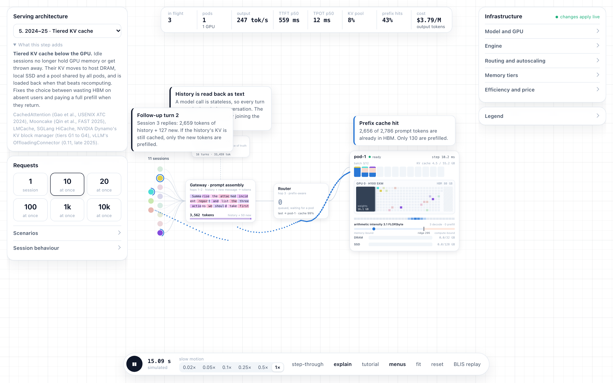

# LLM Serving Explorer

An interactive, visual explanation of how a modern LLM inference stack serves requests: from text to tokens, through the router, into a pod's batch, and down to KV-cache blocks on the GPU.



It has two views:

| View | What it is | Driven by |
|---|---|---|
| **Live graph** (`/`) | One animated graph that starts empty and grows as requests arrive. Runs in slow motion, explains each event next to the node where it happens, and lets you change the model, GPU, engine and routing settings while requests are in flight. | A small teaching model in the browser ([`web/src/live/`](web/src/live/)) |
| **BLIS replay** (`/classic.html`) | Ten tabbed views over nine guided scenarios, with side-by-side comparison and custom runs. | Event files produced by [BLIS](https://github.com/inference-sim/inference-sim), a calibrated discrete-event simulator of vLLM and llm-d |

The two views make different promises. The replay view contains no simulation logic: every number comes from a BLIS run. The live graph is illustrative; [ADR 0004](docs/adr/0004-live-graph-view.md) says which parts are exact, and [docs/design-choices.md](docs/design-choices.md) lists where sources disagree and which reading the model takes.

## What it shows

- **Routing.** Admission, per-pod scoring (prefix-cache affinity, queue depth, KV utilisation), and what happens when cache affinity overloads one pod.
- **Continuous batching.** Iteration-level scheduling in vLLM, mixed prefill and decode steps, and the contrast with one request at a time.
- **Paged KV cache and prefix caching.** GPU memory split into weights and KV blocks, block sharing between requests with a common prefix, and LRU eviction.
- **Preemption.** What the engine does when KV memory runs out, and why overload turns into thrashing.
- **Memory tiers.** KV blocks moving from GPU memory to host DRAM, SSD and a shared pool, and when loading beats recomputing.
- **Prefill/decode disaggregation.** Separate prefill and decode pools with KV transfer between pods.
- **Roofline.** Per-step arithmetic intensity against the GPU's compute and memory-bandwidth limits, and tensor parallelism across GPUs.
- **Autoscaling.** Pods being created, loading weights, becoming ready, draining and terminating as traffic changes.
- **Speculative decoding, load shedding and static batching** as switches in the live graph.

## Quickstart

You need Node.js 22+, pnpm 12+ and Go 1.27.2+ (Go is used to build the simulator).

```bash
git clone --recurse-submodules <this repository>
cd llm-serving-explorer

pnpm install
pnpm engine:patch     # apply this repo's patch to the pinned BLIS submodule
pnpm build:wasm       # build BLIS for the browser (about 27 MB gzipped, not committed)

pnpm --filter @llm-viz/web dev
```

Open the URL Vite prints. The guided scenarios ship as pre-generated event files, so the replay view works without running the simulator. `pnpm build:wasm` is only needed for custom runs in the browser and for the test suite.

For faster custom runs, start the local runner in a second terminal. It drives the native BLIS binary (about 60 ms per run) and the app uses it when it is up:

```bash
pnpm --filter @llm-viz/local-runner start
```

## How it fits together

```
scenarios/*.yaml ──▶ BLIS (engine/, Go) ──▶ events.ndjson.gz ──▶ replay state machine ──▶ views
                     --events-output          schema/              web/src/replay/         web/src/views/
```

| Path | Role |
|---|---|
| [`engine/`](https://github.com/inference-sim/inference-sim) | Git submodule: upstream BLIS, pinned to one commit. |
| [`engine-patches/`](engine-patches/) | The changes this project makes to BLIS: an `--events-output` flag that writes a structured event stream. Observation only; simulation results are byte-identical with and without it. |
| [`schema/`](schema/) | JSON Schema for the event stream, generated TypeScript types and a stream validator. |
| [`scenarios/`](scenarios/) | Nine guided scenarios: configuration, narrative, assertions on what each one must show, and the generated event files. |
| [`tools/gen-scenarios/`](tools/gen-scenarios/) | Builds BLIS, runs every scenario and validates the output against the schema. Output is deterministic. |
| [`tools/local-runner/`](tools/local-runner/) | Small local HTTP server that runs native BLIS for custom runs. |
| [`web/`](web/) | React 19 + Vite app: replay state machine, event registry, views, the live graph and the WASM worker. |

### The BLIS patch

`engine/` tracks upstream `inference-sim` unchanged. The event-stream instrumentation lives in [`engine-patches/0001-events-output.patch`](engine-patches/0001-events-output.patch) and is applied on top with `pnpm engine:patch`. After applying it, `engine/PATCHES.md` describes every file it touches and the invariants it keeps. The patch is intended for contribution upstream; once it is merged there, the patch file goes away and the submodule pin moves forward.

To change the instrumentation, edit files in `engine/` and run `pnpm engine:export-patch`.

## Development

```bash
pnpm test                               # unit and integration tests
pnpm --filter @llm-viz/web typecheck
pnpm --filter @llm-viz/web test:e2e     # Playwright (first time: pnpm --filter @llm-viz/web exec playwright install chromium)
pnpm gen:scenarios --rebuild            # regenerate event files after engine or scenario changes
pnpm build                              # static site in web/dist/
```

To host under a subpath, set the base path: `VITE_BASE_PATH="/llm-serving-explorer/" pnpm build`.

See [CONTRIBUTING.md](CONTRIBUTING.md) for how to add a scenario, extend the event schema or change the BLIS patch.

## Accuracy

- The replay view is as accurate as BLIS. The pinned versions and what BLIS does not model are in [ADR 0001](docs/adr/0001-blis-as-engine.md) and on the app's Accuracy tab. Roofline FLOPs and bytes are computed analytically from the batch shape and marked as derived.
- The live graph is a teaching model with adjustable parameters. Its formulas are unit-tested against published numbers where those exist; [docs/design-choices.md](docs/design-choices.md) separates what is tested, what sits inside a measured range and what is structural only.
- Terms are defined in [GLOSSARY.md](GLOSSARY.md). Design decisions are recorded in [docs/adr/](docs/adr/).

## License

[Apache-2.0](LICENSE). BLIS (`inference-sim`) is also Apache-2.0; the patch in `engine-patches/` is a derivative of it.
