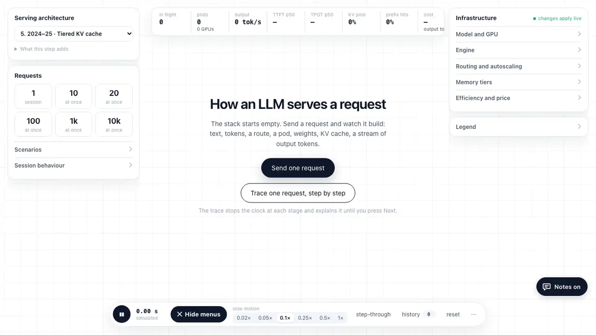

<h1 align="center">LLM Serving Explorer</h1>

<p align="center">
  <b>Watch an LLM inference stack serve requests, one token at a time.</b>
</p>

<p align="center">
  <a href="https://dbtmpl.github.io/llm-serving-explorer/"><b>Open the live site</b></a>
</p>

<p align="center">
  <a href="https://github.com/dbtmpl/llm-serving-explorer/actions/workflows/ci.yml"></a>
  <a href="./LICENSE"></a>
  
  
  
  
</p>

LLM Serving Explorer is an interactive, animated explanation of how a modern inference stack serves requests. A single graph starts empty and grows as requests arrive: text becomes tokens, the router picks a pod, the engine batches work step by step, and KV-cache blocks fill, move and get evicted on the GPU. It runs in slow motion in your browser, explains each event where it happens, and lets you change the model, hardware and policies while requests are in flight.

The simulation is an independent TypeScript model that runs entirely in the browser. It re-implements the scheduling and memory behaviour of [vLLM](https://github.com/vllm-project/vllm) (continuous batching, chunked prefill, paged KV blocks, block-level prefix caching, preemption by recompute) and the routing and prefill/decode design of [llm-d](https://github.com/llm-d/llm-d), as described in their documentation and, for key rules, checked against the vLLM source. Step times come from closed-form roofline formulas. It does not run vLLM or llm-d code and is not calibrated against a real deployment or a simulator, so the mechanisms follow the real systems while absolute numbers are indicative. See [How accurate is it?](#how-accurate-is-it)

<p align="center">
  
</p>

<p align="center">
  <a href="docs/assets/demo.mp4">Watch the demo in full HD (1080p, 60 fps)</a>
</p>

## About

Serving an LLM is a systems problem as much as a model problem. Throughput, latency and cost come out of how the router, the scheduler and the memory hierarchy interact, and those interactions are hard to see in metrics or in text. This project makes them visible.

**What you can watch**

- **Routing.** Per-pod scoring on prefix-cache affinity, queue depth and KV utilisation, and what happens when affinity overloads one pod.
- **Continuous batching.** Requests joining and leaving the batch at every engine step, with prefill chunks and decode tokens sharing a step.
- **Paged KV cache and prefix caching.** GPU memory split into weights and KV blocks, with blocks shared between requests that have a common prefix.
- **Eviction and preemption.** What the engine gives up when memory runs out, and why overload turns into thrashing.
- **Memory tiers.** KV moving from GPU memory to host DRAM, SSD and a shared remote pool, and when loading it back beats recomputing.
- **Prefill/decode disaggregation.** Separate pools with KV transfer between pods.
- **Roofline.** Each step's arithmetic intensity against the GPU's compute and memory-bandwidth limits.
- **Autoscaling.** Pods being created, loading weights, serving, draining and terminating.

**What you can change while it runs**

- Model, GPU and tensor parallelism
- Engine settings such as `max_num_seqs`, the token budget, the admission rule and speculative decoding
- Routing policy, autoscaling limits and load shedding
- Tier sizes and session behaviour (follow-up turns, idle time, churn)
- The serving architecture, as a timeline from static batching to today's tiered, disaggregated stacks

A built-in tutorial walks through the graph, and a step-through mode follows one request and stops the clock at each event.

## Getting Started

You need [Node.js](https://nodejs.org) 22+ and [pnpm](https://pnpm.io) 12+.

```bash
git clone https://github.com/dbtmpl/llm-serving-explorer.git
cd llm-serving-explorer
pnpm install
pnpm dev
```

Open the URL that Vite prints and press **Send one request**.

To build the static site:

```bash
pnpm build      # output in dist/
pnpm preview    # serve the build locally
```

The build is a plain static bundle with no backend, so any static host can serve it. If it is served from a subpath, set the base path: `VITE_BASE_PATH="/llm-serving-explorer/" pnpm build`.

## What is modelled, and where it comes from

Every mechanism in the simulation is an implementation of a published or deployed approach, lives in its own module, names its sources, and is unit-tested against them. This table is generated from the code. The "Verified against BLIS" column names the [conformance scenarios](conformance/README.md) that check an approach against the llm-d router and vLLM's scheduler as BLIS runs them; [what that agreement does and does not show](docs/blis-parity.md), with every known difference, is on its own page.

<!-- generated:approaches:start -->
| Concept | Approach | What it does | Fidelity | Verified against BLIS | Sources |
|---|---|---|---|---|---|
| [Cost model](src/sim/cost/) | Roofline step time | A step takes the longer of FLOPs over peak compute and bytes over memory bandwidth. | Exact | Yes: 20 scenarios | [Williams et al., CACM 2009](https://doi.org/10.1145/1498765.1498785) |
| [Cost model](src/sim/cost/) | FLOPs per token | 2N per token through the weights, plus an attention term linear in context length. | Exact | Yes: 20 scenarios | [Kaplan et al., 2020](https://arxiv.org/abs/2001.08361); [Vaswani et al., NeurIPS 2017](https://arxiv.org/abs/1706.03762) |
| [Cost model](src/sim/cost/) | KV bytes per token and memory budget | Two vectors per layer and KV head per token; the KV pool is what weights, activations, CUDA graphs and headroom leave of the memory the driver reports. | Exact | Yes: `kv-budget-8b-h100`, `kv-budget-70b-h200-tp4` | [Kwon et al., SOSP 2023](https://arxiv.org/abs/2309.06180); [vLLM docs, engine arguments](https://docs.vllm.ai/en/latest/configuration/engine_args.html); [vLLM source, worker memory profiling](https://github.com/vllm-project/vllm/blob/main/vllm/v1/worker/gpu_worker.py); [BLIS substrate registry, cost-model-memory](https://github.com/inference-sim/blis-substrate/blob/main/registry/coefficients/cost-model-memory.yaml) |
| [Cost model](src/sim/cost/) | Tensor parallelism | Weights and KV are split evenly over the GPUs of a pod; compute and bandwidth add up. | Simplified | Yes: 7 scenarios | [Shoeybi et al., 2019](https://arxiv.org/abs/1909.08053) |
| [Cost model](src/sim/cost/) | Host time per step | A fixed plus per-sequence CPU cost that adds to, or overlaps with, GPU time. | Simplified | Yes: 20 scenarios | [vLLM docs, optimization](https://docs.vllm.ai/en/latest/configuration/optimization.html) |
| [Step scheduling](src/sim/engine/) | Chunked prefill under a token budget | A long prompt is prefilled in chunks sharing each step with decodes, bounded by a per-step token budget. | Structural | Yes: `timing-8b-h100-burst`, `timing-8b-h100-heavy`, `preemption-overflow` | [Agrawal et al., OSDI 2024](https://arxiv.org/abs/2403.02310); [Agrawal et al., 2023](https://arxiv.org/abs/2308.16369); [vLLM source, scheduler.py](https://github.com/vllm-project/vllm/blob/main/vllm/v1/core/sched/scheduler.py); [vLLM source, config/scheduler.py](https://github.com/vllm-project/vllm/blob/main/vllm/config/scheduler.py) |
| [Batching](src/sim/batching/) | Static batching | A batch runs to completion before the next one is formed. | Structural | Not verifiable | [Crankshaw et al., NSDI 2017](https://arxiv.org/abs/1612.03079); [NVIDIA Triton docs](https://docs.nvidia.com/deeplearning/triton-inference-server/user-guide/docs/user_guide/batcher.html); [Yu et al., OSDI 2022](https://www.usenix.org/conference/osdi22/presentation/yu) |
| [Batching](src/sim/batching/) | Continuous batching | Requests join and leave the batch at every engine step. | Structural | Yes: 22 scenarios | [Yu et al., OSDI 2022](https://www.usenix.org/conference/osdi22/presentation/yu); [vLLM source, scheduler.py](https://github.com/vllm-project/vllm/blob/main/vllm/v1/core/sched/scheduler.py) |
| [KV admission](src/sim/admission/) | On-demand (paged) | Allocate blocks for the tokens scheduled this step; grow as the sequence grows. | Structural | Yes: `preemption-overflow`, `queue-deadline-shedding` | [Kwon et al., SOSP 2023](https://arxiv.org/abs/2309.06180); [vLLM source, scheduler.py](https://github.com/vllm-project/vllm/blob/main/vllm/v1/core/sched/scheduler.py) |
| [KV admission](src/sim/admission/) | Whole prompt | Allocate blocks for the full prompt at admission; outputs grow on demand. | Structural | Not verifiable | [Kwon et al., SOSP 2023](https://arxiv.org/abs/2309.06180) |
| [KV admission](src/sim/admission/) | Reserve to completion | Reserve prompt plus max_tokens up front; admitted requests are never preempted. | Structural | Not verifiable | [Kwon et al., SOSP 2023](https://arxiv.org/abs/2309.06180); [TensorRT-LLM docs](https://nvidia.github.io/TensorRT-LLM/); [Yu et al., OSDI 2022](https://www.usenix.org/conference/osdi22/presentation/yu) |
| [KV cache layout](src/sim/kvcache/) | Paged KV blocks (PagedAttention) | KV memory is handed out in fixed 16-token blocks as tokens are written, like virtual-memory pages. | Structural | Yes: 4 scenarios | [Kwon et al., SOSP 2023](https://arxiv.org/abs/2309.06180) |
| [Prefix reuse](src/sim/kvcache/) | Block-hash prefix cache | Reuse whole KV blocks whose entire token prefix matches; always compute the last token. | Exact | Yes: 4 scenarios | [vLLM docs, prefix caching](https://docs.vllm.ai/en/latest/design/prefix_caching.html); [Kwon et al., SOSP 2023](https://arxiv.org/abs/2309.06180) |
| [Eviction order](src/sim/kvcache/) | LRU, whole session | Evict the idle session that was used longest ago. | Simplified | Yes: `eviction-pressure`, `tiers-offload` | [Gao et al., USENIX ATC 2024](https://arxiv.org/abs/2403.19708); [vLLM docs, prefix caching](https://docs.vllm.ai/en/latest/design/prefix_caching.html) |
| [KV tiers](src/sim/kvcache/) | HBM → DRAM → SSD → shared pool | Idle sessions move down a memory hierarchy instead of being dropped, and are loaded back on return. | Structural | Yes: `tiers-offload` | [Gao et al., USENIX ATC 2024](https://arxiv.org/abs/2403.19708); [Qin et al., FAST 2025](https://arxiv.org/abs/2407.00079); [Liu et al., 2025 (LMCache)](https://arxiv.org/abs/2510.09665); [llm-d docs, KV offloader](https://github.com/llm-d/llm-d/blob/main/docs/architecture/kv-management/kv-offloader.md); [NVIDIA Dynamo docs](https://docs.nvidia.com/dynamo/latest/) |
| [Reload decision](src/sim/kvcache/) | Adaptive load-or-recompute | Load KV from a lower tier only when copying is faster than prefilling again. | Simplified | Not verifiable | [Liu et al., 2025 (LMCache)](https://arxiv.org/abs/2510.09665); [Liu et al., SIGCOMM 2024](https://arxiv.org/abs/2310.07240) |
| [Preemption](src/sim/kvcache/) | Preempt newest, recompute | Free the most recently admitted sequence and prefill it again later. | Exact | Yes: `preemption-overflow` | [vLLM source, scheduler.py](https://github.com/vllm-project/vllm/blob/main/vllm/v1/core/sched/scheduler.py); [vLLM docs, optimization](https://docs.vllm.ai/en/latest/configuration/optimization.html); [Kwon et al., SOSP 2023](https://arxiv.org/abs/2309.06180) |
| [Decoding](src/sim/decoding/) | Autoregressive | One token per sequence per step. | Exact | Yes: 20 scenarios | [Vaswani et al., NeurIPS 2017](https://arxiv.org/abs/1706.03762) |
| [Decoding](src/sim/decoding/) | Speculative decoding | A draft model proposes several tokens; the target verifies them in one pass. | Exact | Yes: `spec-decoding`, `calib-8b-h100-spec` | [Leviathan et al., ICML 2023](https://arxiv.org/abs/2211.17192) |
| [Routing](src/sim/routing/) | Round robin | Rotate through pods regardless of load or cache. | Exact | Yes: `routing-round-robin`, `routing-prefix-vs-round-robin` | [Envoy docs, load balancers](https://www.envoyproxy.io/docs/envoy/latest/intro/arch_overview/upstream/load_balancing/load_balancers) |
| [Routing](src/sim/routing/) | Least loaded | Send to the pod with the fewest requests in flight. | Simplified | Yes: `routing-least-loaded` | [Envoy docs, load balancers](https://www.envoyproxy.io/docs/envoy/latest/intro/arch_overview/upstream/load_balancing/load_balancers) |
| [Routing](src/sim/routing/) | Prefix-cache aware | Weighted score of cached prefix, KV utilisation and queue depth, as in llm-d. | Structural | Yes: 4 scenarios | [llm-d docs, router scheduling](https://github.com/llm-d/llm-d/blob/main/docs/architecture/router/scheduling.md); [Gateway API Inference Extension](https://github.com/kubernetes-sigs/gateway-api-inference-extension) |
| [Prefill/decode disaggregation](src/sim/disaggregation/) | Decode-first with token threshold | Pick the decode pod first; use the prefill pool only when enough of the prompt is uncached there. | Structural | Yes: `pd-disaggregation`, `calib-8b-h100-pd` | [llm-d docs, P/D disaggregation](https://github.com/llm-d/llm-d/blob/main/docs/architecture/disaggregation/pd-disaggregation.md); [Zhong et al., OSDI 2024](https://arxiv.org/abs/2401.09670); [Patel et al., ISCA 2024](https://arxiv.org/abs/2311.18677) |
| [Autoscaling](src/sim/autoscaling/) | Target concurrency | Run enough pods that each carries at most its target number of requests. | Simplified | Yes: `autoscale-overload` | [Knative docs, autoscaling](https://knative.dev/docs/serving/autoscaling/autoscaling-concepts/); [llm-d docs, autoscaling](https://github.com/llm-d/llm-d/blob/main/docs/architecture/autoscaling/keda-epp.md) |
| [Flow control](src/sim/flowcontrol/) | Deadline shedding | Reject requests that have waited at the router longer than a time-to-live. | Simplified | Yes: `queue-deadline-shedding` | [llm-d docs, flow control](https://github.com/llm-d/llm-d/blob/main/docs/architecture/router/flow-control.md) |
| [Workload](src/sim/workload/) | Closed-loop multi-turn sessions | Users wait for an answer, think, then re-send the whole conversation plus a new message. | Simplified | Not verifiable | [Schroeder et al., NSDI 2006](https://www.usenix.org/conference/nsdi-06/presentation/open-versus-closed-cautionary-tale); [Gao et al., USENIX ATC 2024](https://arxiv.org/abs/2403.19708) |
| [Workload](src/sim/workload/) | Trace replay | Requests are injected at recorded times with recorded lengths, so a run can be repeated or compared exactly. | Simplified | Not verifiable | [Schroeder et al., NSDI 2006](https://www.usenix.org/conference/nsdi-06/presentation/open-versus-closed-cautionary-tale); [Gao et al., USENIX ATC 2024](https://arxiv.org/abs/2403.19708) |
<!-- generated:approaches:end -->

**Fidelity** says how closely an approach follows its source. *Exact*: a published formula or rule, reproduced and tested against it. *Structural*: the source's mechanism with our own constants, exposed as parameters. *Simplified*: a stand-in whose documentation says what is left out.

The full list of sources, with links, is in [`src/sim/README.md`](src/sim/README.md#sources). Each module's README lists what it does not model.

## How accurate is it?

The simulation is a teaching model, not a calibrated simulator. It aims to get the mechanisms and their orders of magnitude right.

- **Exact where the sources are exact.** KV bytes per token, memory budgets, FLOPs, ridge points, roofline step times and speculative-decoding speed-ups are closed-form and tested against worked numbers.
- **Adjustable where they are not.** Host time per step, tier copy rates and utilisation factors sit inside plausible ranges and are exposed as controls.
- **Checked against source code where behaviour matters.** For example, vLLM's preemption order, its rule of admitting nothing in a step that preempted, and its default `max_num_seqs`.
- **Deterministic.** A seed and a sequence of inputs always give the same event stream; ten such streams are pinned by tests.

[docs/design-choices.md](docs/design-choices.md) lists, topic by topic, what the sources say, where they disagree and which reading the model takes.

## Project Layout

| Path | Contents |
|---|---|
| [`src/sim/`](src/sim/) | The simulation: one module per concept (routing, batching, KV cache, ...), each with its own README, sources and tests |
| [`src/sim/citations.ts`](src/sim/citations.ts) | The registry of every paper, document and datasheet the model relies on |
| [`src/live/`](src/live/) | The user interface: canvas rendering, menus, inspector, tutorial and callouts |
| [`e2e/`](e2e/) | Playwright end-to-end tests |
| [`docs/`](docs/) | Design choices and architecture decision records |

The simulation has no dependency on the interface and can be run on its own:

```ts
import { DEFAULT_PARAMS, advance, createWorld, spawnBurst } from "./src/sim/index.js";

const world = createWorld({ ...DEFAULT_PARAMS, routing: "prefix-aware" });
spawnBurst(world, 100);   // 100 sessions arrive at once
advance(world, 30);       // 30 simulated seconds
console.log(world.m.completed, world.m.preemptions);
```

To model a new paper, add an approach to the module that owns the decision: see [`src/sim/README.md`](src/sim/README.md).

## Development

```bash
pnpm typecheck
pnpm test         # unit tests, one suite per simulation module
pnpm test:e2e     # Playwright (first time: pnpm exec playwright install chromium)
pnpm docs:sync    # regenerate the tables in the READMEs from the code
```

## Contributing

Contributions are welcome. See [CONTRIBUTING.md](CONTRIBUTING.md) for the workflow and for how changes to the model should be sourced and tested. Terms are defined in [GLOSSARY.md](GLOSSARY.md).

## License

[Apache-2.0](LICENSE)
